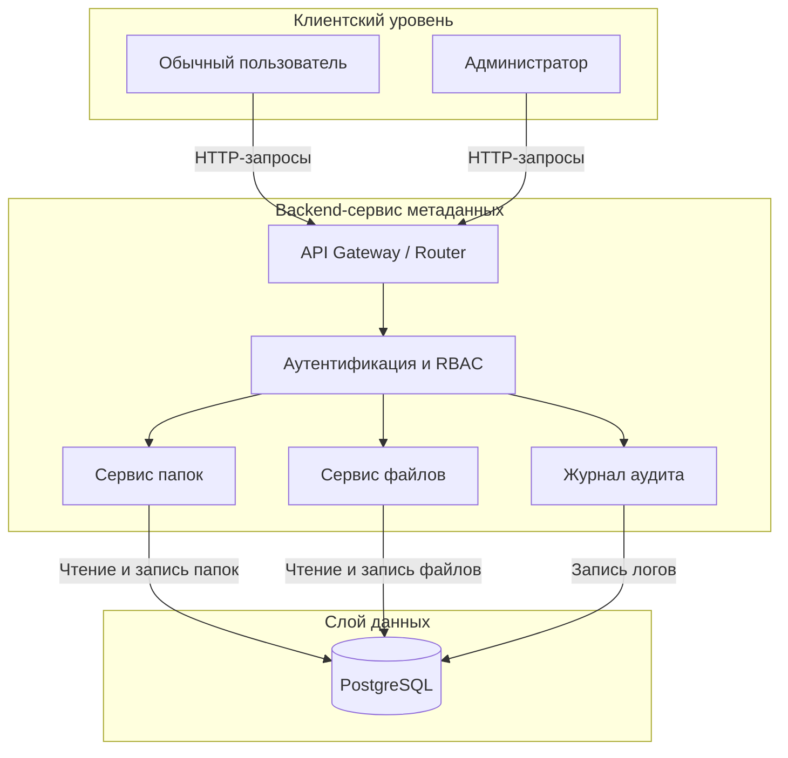

# Файловое хранилище

---

## 1. Краткое описание системы

Система представляет собой backend-сервис для каталогизации, структурирования и поиска информации о пользовательских файлах и папках (учёт метаданных). Сервис организует изолированное виртуальное файловое пространство с разграничением прав доступа на основе ролевой модели. На данном этапе физические бинарные файлы на сервере не сохраняются — система оперирует исключительно метаинформацией, фиксируя структуру каталогов, атрибуты сущностей и историю административных вмешательств.

### Какую задачу решает система
* Предоставление пользователю изолированного дерева каталогов для логической организации метаданных файлов.
* Разграничение зон видимости: пользователь оперирует только своими каталогами и файлами.
* Предоставление администратору сквозного доступа для аудита, перемещения или удаления объектов пользователей.
* Предотвращение потери данных за счёт механизма мягкого удаления (корзина) с возможностью восстановления.

---

## 2. Перечень предполагаемых пользователей

* **Обычный пользователь (роль `user`):**
  * Авторизованный клиент, работающий строго внутри своего пространства.
  * Создаёт и вкладывает папки, добавляет метаданные файлов, перемещает свои объекты в корзину и выполняет регистронезависимый поиск по имени.
  * Не видит чужих каталогов и не может изменять чужие файлы.
* **Администратор (роль `admin`):**
  * Пользователь с расширенными правами, обладающий доступом ко всей файловой иерархии сервиса.
  * Просматривает, восстанавливает, перемещает и удаляет объекты любого пользователя при разборе инцидентов.
  * Каждая мутирующая операция администратора над чужими данными обязательно логируется в журнале аудита.
  
 ---
 
## 3. Перечень основных объектов системы

1. **User (Пользователь):** учетная запись участника системы, хранящая данные авторизации и определяющая уровень прав доступа.
2. **Folder (Папка):** виртуальный каталог для логической группировки файлов и дочерних подпапок.
3. **File (Метаданные файла):** учетная карточка метаданных файла (название, размер, MIME-тип), привязанная к конкретной папке.
4. **AuditLog (История действий администратора):** неизменяемый журнал операций администратора над объектами пользователей.

---

## 4. Описание объектов, их связей и правил предметной области

### Атрибутный состав объектов
* **User:**
  * `id` — уникальный идентификатор (PK, UUID).
  * `login` — уникальный логин для входа в систему (string, обязательное).
  * `password_hash` — хэш пароля для авторизации (string, обязательное).
  * `username` — публичное отображаемое имя (string, может повторяться).
  * `role` — роль в системе: `user` или `admin` (string, по умолчанию `user`).
  * `created_at` — дата и время регистрации (timestamp).
* **Folder:**
  * `id` — уникальный идентификатор (PK, UUID).
  * `name` — название папки (string, не пустое).
  * `user_id` — владелец каталога (FK на `User`, обязательное).
  * `parent_id` — ссылка на родительскую папку (FK на `Folder`, nullable; у корня `NULL`).
  * `is_deleted` — флаг нахождения в корзине (bool, по умолчанию `false`).
  * `deleted_at` — дата перемещения в корзину (timestamp, nullable).
  * `created_at` / `updated_at` — даты создания и изменения (timestamp).
* **File:**
  * `id` — уникальный идентификатор (PK, UUID).
  * `name` — название файла с расширением (string, не пустое).
  * `size_bytes` — размер файла в байтах (int, неотрицательное число $\ge 0$).
  * `mime_type` — формат данных (string, например `application/pdf`).
  * `folder_id` — директория размещения (FK на `Folder`, обязательное, `NOT NULL`).
  * `user_id` — владелец файла (FK на `User`, обязательное).
  * `is_deleted` — флаг нахождения в корзине (bool, по умолчанию `false`).
  * `deleted_at` — дата перемещения в корзину (timestamp, nullable).
  * `created_at` / `updated_at` — даты создания и изменения (timestamp).
* **AuditLog:**
  * `id` — уникальный идентификатор записи (PK, UUID).
  * `admin_id` — администратор, выполнивший действие (FK на `User`, обязательное).
  * `action` — тип операции: `DELETE`, `MOVE`, `RENAME` (string, обязательное).
  * `entity_type` — тип затронутого объекта: `FILE`, `FOLDER` (string, обязательное).
  * `entity_id` — идентификатор измененного объекта (UUID, обязательное).
  * `created_at` — дата и время события (timestamp).

### Связи между объектами
* **User -> Folder (`1:N`):** один пользователь может владеть множеством папок. Каждая папка принадлежит строго одному пользователю (`user_id NOT NULL`). Папка без владельца существовать не может.
* **User -> File (`1:N`):** один пользователь может владеть множеством файлов. Файл без владельца существовать не может.
* **User (Admin) -> AuditLog (`1:N`):** администратор инициирует создание записей в журнале при действиях над чужими объектами.
* **Folder -> File (`1:N`):** одна папка содержит множество файлов. Файл не может существовать вне папки (`folder_id NOT NULL`).
* **Folder -> Folder (`1:N`, рекурсивная связь):** папка может содержать вложенные подпапки через поле `parent_id`. У корневого каталога пользователя `parent_id = NULL`.

### Правила предметной области (Бизнес-логика)
* **Изоляция данных:** обычный пользователь имеет доступ только к своим папкам и файлам. Передача объектов между пользователями не поддерживается.
* **Разграничение login и username:** `login` уникален и используется строго для входа; `username` — это отображаемый никнейм, который может быть одинаковым у разных пользователей.
* **Вычисляемые поля:** размер папки и количество файлов внутри неё **не хранятся** отдельными полями в БД во избежание рассинхронизации. Они вычисляются «на лету» через агрегатные функции SQL (`SUM` и `COUNT`).
* **Коллизии имён:** одинаковые имена файлов или подпапок в одном каталоге разрешены. При совпадении система запрашивает подтверждение и добавляет суффикс `(n)` (например, `Музыка (1)`).
* **Корзина (Soft Delete):** удаление не стирает строки физически, а выставляет `is_deleted = true` и фиксирует `deleted_at`. Удаление папки выполняется каскадно: помечается удалённой сама папка и всё её содержимое.
* **Поиск:** поиск файлов осуществляется по вхождению подстроки в имя файла без учёта регистра.
* **Удаление учетной записи пользователя:** пользователь не удаляется физически из БД, а помечается флагом `is_deleted = true`. При этом срабатывает каскадный Soft Delete: все вложенные каталоги и файлы данного пользователя автоматически помечаются удаленными (`is_deleted = true`).
* **Границы редактирования:** пользователю разрешено изменять название файла (`name`), название папки (`name`) и перемещать файл в другую принадлежащую ему папку (`folder_id`). Изменять размер файла (`size_bytes`), его тип (`mime_type`), дату создания или передавать объект другому владельцу запрещено.
* **Сортировка объектов:**
  * По типу — выполняется на основе поля `mime_type`.
  * По дате — по умолчанию используется дата создания `created_at`; опционально доступна сортировка по дате последней модификации `updated_at`.
  * По размеру — для файлов используется `size_bytes`, для папок — динамически агрегированная сумма размеров.

 ---

## 5. ER-Диаграмма

```mermaid
erDiagram
	USER ||--o{ FOLDER : owns
    USER ||--o{ FILE : owns
    USER ||--o{ AUDIT_LOG : logs
    FOLDER ||--o{ FILE : contains

    USER {
        uuid user_id PK
        string login UK
        string password_hash
        string username
        string role
        timestamp created_at
    }

    FOLDER {
        uuid folder_id PK
        uuid user_id FK
        uuid parent_id FK
        string name
        bool is_deleted
        timestamp deleted_at
        timestamp created_at
        timestamp updated_at
    }

    FILE {
        uuid id PK
        uuid user_id FK
        uuid folder_id FK
        string name
        int size_bytes
        string mime_type
        bool is_deleted
        timestamp deleted_at
        timestamp created_at
        timestamp updated_at
    }

    AUDIT_LOG {
        uuid id PK
        uuid admin_id FK
        string action
        string entity_type
        uuid entity_id
        timestamp created_at
    }
 ```
 
 ---
 
## 6. Описание сценариев использования

### Сценарий 1: Регистрация и первичная инициализация хранилища
1. Пользователь отправляет запрос на регистрацию с указанием `login`, `password` и `username`.
2. Система проверяет уникальность `login` в базе данных и валидность пароля.
3. Сервис хэширует пароль и сохраняет запись в таблице `User` с ролью по умолчанию `user`.
4. Система автоматически создает персональную корневую папку (`parent_id = NULL`) с флагом системного каталога, закрепляя её за созданным пользователем.
5. Пользователь получает подтверждение успешного создания аккаунта и идентификатор своего рабочего пространства.

### Сценарий 2: Добавление файла с обработкой коллизии имён
1. Пользователь передает метаданные файла (имя, размер, MIME-тип) и идентификатор целевой папки (`folder_id`).
2. Система верифицирует права доступа: проверяет, что папка принадлежит текущему пользователю и не находится в корзине (`is_deleted = false`).
3. Система проверяет наличие активных файлов с аналогичным именем в этой же папке:
   * Если файл с таким именем уже существует, запрашивается подтверждение на переименование и к имени файла автоматически присваивается суффикс `(n)` (например, `document (1).pdf`).
4. Метаданные сохраняются в таблице `File` с привязкой к папке и владельцу.
5. Пользователь получает карточку созданного файла с присвоенным `id` и итоговым именем.

### Сценарий 3: Каскадное удаление папки в корзину (Soft Delete)
1. Пользователь инициирует удаление папки по её `folder_id`.
2. Система проверяет наличие вложенных файлов и дочерних подпапок:
   * При обнаружении содержимого клиенту возвращается предупреждение о каскадной операции.
3. После получения флага подтверждения от клиента система выполняет транзакцию:
   * Для целевой папки, всех её дочерних подпапок и всех содержащихся в них файлов выставляется флаг `is_deleted = true`, а также текущее время в поле `deleted_at`.
4. Клиент получает подтверждение об успешном перемещении дерева каталога в корзину.

### Сценарий 4: Административное вмешательство и аудит
1. Администратор (пользователь с `role = admin`) находит объект (папку или файл) любого пользователя и отправляет команду на его принудительное удаление или перемещение.
2. Сервис проверяет уровень привилегий инициатора запроса.
3. Система выполняет операцию над целевой сущностью.
4. В рамках той же транзакции создается неизменяемая запись в таблице `AuditLog`: фиксируются `admin_id`, тип действия (`DELETE`/`MOVE`), тип сущности (`FILE`/`FOLDER`), идентификатор целевого объекта `entity_id` и метка времени `created_at`.
5. Администратор получает результат выполнения операции, а изменения отражаются в журнале аудита.

---

## 7. Sequence-диаграмма сценария добавления файла с проверкой прав

```mermaid
sequenceDiagram
    autonumber
    participant U as Пользователь
    participant S as Сервис (APP)
    participant DB as База данных (Data)

    U->>S: Добавить файл<br/>(folder_id, meta)
    activate S

    S->>DB: Проверка прав<br/>на папку
    activate DB
    DB-->>S: Папка валидна
    deactivate DB

    alt Ошибка доступа / Нет папки
        S-->>U: 403 Forbidden / 404
    else Доступ разрешен
        S->>DB: Проверить дубликат<br/>имени в папке
        activate DB
        DB-->>S: Имя занято
        deactivate DB

        opt Коллизия имени
            S->>S: Присвоить имя (n)
        end

        S->>DB: Сохранить файл
        activate DB
        DB-->>S: OK (file_id)
        deactivate DB

        S-->>U: 201 Created<br/>(карточка файла)
    end
    deactivate S
```

## 8. Общая схема системы (Flowchart)
	

